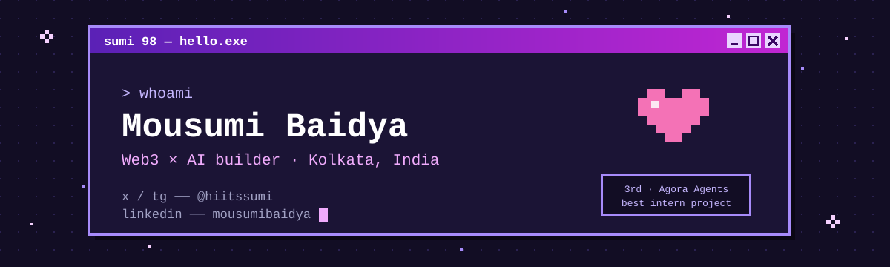

### Hi there, welcome! 👋

  

  

I'm **Mousumi Baidya**, a developer from **Kolkata, India** working on **Web3 and AI**.
I've been building since 2025, and I build in public.

- BCA, 3rd year @ **The Heritage Academy** · Class of 2028
- **3rd place, Agora Agents Hackathon** (Canteen × Circle × Arc) with [Rugjeez](https://github.com/SachPlayZ/Rugjeez)
- Built [Brier](https://github.com/hiitssumi/Brier) as an intern at **Euphoria GenX**, where it was selected as the **best project** of the cohort
- Portfolio: [hiitssumi.vercel.app](https://hiitssumi.vercel.app)

 

## Featured projects

### [Rugjeez](https://github.com/SachPlayZ/Rugjeez) · [Live](https://rugjeez.vercel.app)
**3rd place, Agora Agents Hackathon.** An autonomous agent that flags likely rug pulls from on-chain signals, opens a prediction market on Arc, and logs every decision to IPFS.

`Solidity` · `Foundry` · `Python` · `FastAPI` · `web3.py` · `Groq LLM` · `IPFS` · `Next.js` · `viem` · `Circle Wallets`

### [Brier](https://github.com/hiitssumi/Brier) · [Live demo](https://brierapp.streamlit.app)
**Internship project at Euphoria GenX, selected as best project.** Extracts fields from receipts and invoices with calibrated, explainable confidence scores, then flags duplicate expense claims before payout and shows the signals behind each flag. Backed by 387 passing tests on SQLite and PostgreSQL.

`Python` · `Django` · `scikit-learn` · `pandas` · `Tesseract OCR` · `RapidFuzz` · `PostgreSQL` · `pytest`

### [Portfolio](https://github.com/hiitssumi/Portfolio) · [Live](https://hiitssumi.vercel.app)
A scroll-story portfolio in pixel-art style, with a retro **"sumi 98"** desktop of draggable windows, sound and easter eggs.

`Next.js 15` · `TypeScript` · `Tailwind v4` · `GSAP` · `Lenis`

 

## Tools I work with

  

 

## Journey so far

| When | What |
|---|---|
| 2025 | Started building seriously |
| May 2026 | Built Rugjeez at the Agora Agents Hackathon |
| Jun 2026 | Rugjeez placed 3rd |
| Sep 2026 | Shipped Brier at Euphoria GenX, which was selected as best internship project |
| Now | Going deeper into Web3 × AI |

 

## GitHub activity

 

## Let's connect

I'm always happy to talk about **Web3, AI agents, hackathons**, or something interesting you're building.
If you're working on something in this space, whether a role, a collaboration or a hackathon team, my inbox is open.

  
  
  
  
  

Telegram <a href="https://t.me/hiitssumi">@hiitssumi</a> · Discord <code>hi.its.sumi</code>
